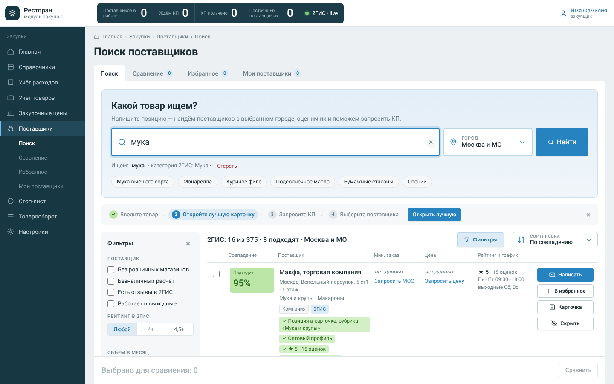
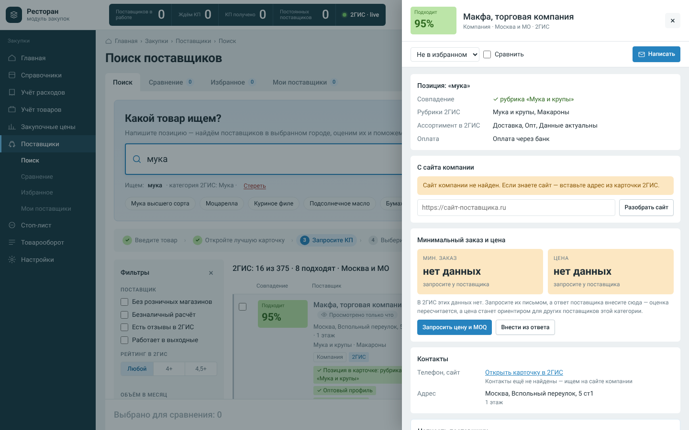
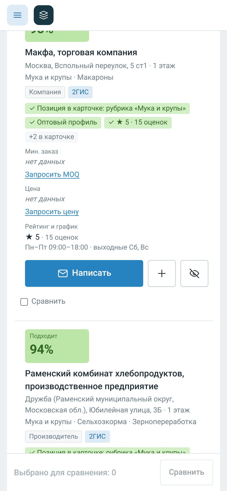

# Поиск поставщиков

[](https://github.com/nikitabannykh/newproject/actions/workflows/ci.yml)


Модуль закупок для ресторана: закупщик вводит товар и город, получает поставщиков с оценкой «насколько подходит», данными с их сайтов и готовым запросом КП.

**Демо:** https://procure-lab-9olgt.vercel.app



## Сценарий

1. **Ввести товар** — «куриное филе», «мука высшего сорта», «бумажные стаканы». Запрос сам раскладывается на категорию и рубрики 2ГИС.
2. **Получить короткий список** — только организации с подходящей рубрикой; филиалы одной сети склеены; кафе, рестораны и администрации отсеяны.
3. **Понять, кому писать первым** — оценка 0–100 с причинами: опт или розница, рубрика, репутация, найденная на сайте позиция и цена, режим работы.
4. **Проверить детали** — карточка компании: товар с сайта с ценой, фасовкой и фото, MOQ, доставка, контакты. У каждого факта — ссылка на источник.
5. **Запросить КП и выбрать** — письмо из карточки по шаблону, внесение ответа, сравнение до 4 компаний, канбан «Избранное» до статуса «Постоянный / Резервный», вкладка «Мои поставщики» по категориям.

<table>
<tr>
<td width="62%"></td>
<td></td>
</tr>
</table>

## Архитектура

```
Браузер ──► Vercel /api/search, /api/count ──► 2ГИС Places API 3.0
        ├─► Vercel /api/enrich ──► Yandex Cloud Function ──► Яндекс Поиск + сайты поставщиков
        └─► Vercel /api/egrul  ──► ЕГРЮЛ ФНС
```

- **2ГИС** — основной источник: крупнейший справочник организаций с рубриками, рейтингами и графиком работы.
- **Краулер в Yandex Cloud** — российские сайты блокируют зарубежные дата-центры, поэтому обход идёт из РФ. Находит сайт через Яндекс Поиск, проверяет, что сайт принадлежит компании, и извлекает товары из Tilda Store, schema.org (JSON-LD и микроразметка) и вёрстки карточек.
- **Vercel** — тонкий шлюз: ключи только на сервере, проверка источника, лимиты, кэш.

Подробно — модель оценки, сопоставление товаров, решения и путь в прод: **[docs/ARCHITECTURE.md](docs/ARCHITECTURE.md)**.

## Структура

```
src/            интерфейс: index.html, styles.css, app.js (без фреймворков)
api/            Vercel Functions: search, count, enrich, egrul, health
lib/
  twogis.mjs    клиент 2ГИС: регионы, нормализация, кэш, ретраи
  enrich.mjs    краулер: поиск сайта, проверка владельца, извлечение и ранжирование товаров
  netguard.mjs  защита от SSRF
  guard.mjs     same-origin, rate limit, LRU-кэш
yc/             обёртка краулера для Yandex Cloud Functions
test/           unit-тесты (node:test)
build.mjs       сборка src/ → public/index.html
server.mjs      локальный сервер с теми же обработчиками
```

## Запуск

Нужен Node.js 18+. Зависимостей нет — `npm install` не требуется.

```bash
cp .env.example .env          # заполнить TWOGIS_KEY
node --env-file=.env server.mjs   # предварительно: npm run build
# → http://localhost:8787
```

| Команда | Что делает |
|---|---|
| `npm run dev` | сборка и локальный сервер |
| `npm test` | unit-тесты |
| `npm run ci` | синтаксис + тесты + сборка (то же, что в GitHub Actions) |
| `npm run build:yc` | бандл краулера для Yandex Cloud |
| `npm run deploy` | деплой на Vercel |

Без ключа 2ГИС интерфейс работает на демо-каталоге.

### Переменные окружения

| Где | Переменная | Назначение |
|---|---|---|
| Vercel | `TWOGIS_KEY` | ключ 2ГИС Places API |
| Vercel | `YC_ENRICH_URL`, `YC_ENRICH_TOKEN` | адрес функции-краулера и общий секрет |
| Vercel | `ALLOWED_HOSTS` | необязательно: домены, которым разрешено вызывать API |
| Yandex Cloud | `SEARCH_API_KEY`, `FOLDER_ID` | Яндекс Поиск для поиска сайтов компаний |
| Yandex Cloud | `TOKEN` | тот же секрет, что `YC_ENRICH_TOKEN` |

### Деплой краулера

```bash
npm run build:yc
yc serverless function version create --function-name supply-enrich \
  --runtime nodejs18 --entrypoint index.handler --memory 256m --execution-timeout 25s \
  --source-path yc/dist --environment SEARCH_API_KEY=…,FOLDER_ID=…,TOKEN=…
```

## Качество

- **Тесты** — защита от SSRF, same-origin и лимиты, нормализация ответа 2ГИС, извлечение товаров из разметки, ранжирование («куриное филе» ≠ «филе лосося», «бедро» выше «филе бедра»).
- **CI** — Node 18/20/22 и сканирование секретов (gitleaks) на каждый push и PR.
- **Безопасность** — CSP и заголовки, SSRF-защита краулера, лимиты на IP, санитизация внешних ссылок. Аудит и оставшиеся риски — в [SECURITY.md](SECURITY.md).

## Ограничения прототипа

- Демо-ключ 2ГИС: до 50 организаций на запрос, без телефонов и сайтов — их добирает краулер.
- MOQ и цены есть на меньшинстве сайтов — основной путь для них запрос КП.
- Избранное, заметки и КП хранятся в браузере (`localStorage`); базы данных и авторизации нет.
