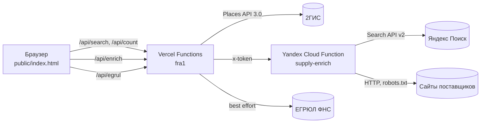

# Архитектура

## Контекст

Закупщик ресторана ищет поставщика конкретной позиции («куриное филе», «бумажные стаканы») в своём городе. Ему нужно за минуты получить короткий список компаний, понять, кому писать первым, и запросить КП. Прототип показывает этот сценарий целиком на реальных данных.

## Компоненты



| Слой | Где | Ответственность |
|---|---|---|
| Интерфейс | `src/` → `public/index.html` | Поиск, оценка, карточка, письмо, сравнение, канбан «Избранное». Состояние — `localStorage` |
| API-шлюз | `api/*.mjs` (Vercel) | Ключи на сервере, проверка источника, лимиты, кэш, валидация параметров |
| Справочник | `lib/twogis.mjs` | Запрос к 2ГИС по рубрикам, нормализация ответа, ретраи |
| Краулер | `lib/enrich.mjs` в `yc/` | Поиск сайта, проверка владельца, извлечение товаров, цен, MOQ, контактов |
| Сетевая защита | `lib/netguard.mjs`, `lib/guard.mjs` | SSRF, same-origin, rate limit, LRU |

## Поток данных

```mermaid
sequenceDiagram
  participant B as Браузер
  participant V as Vercel
  participant G as 2ГИС
  participant Y as Yandex Cloud
  B->>B: «куриное филе» → категория «Мясо и птица», рубрики 562, 712
  B->>V: GET /api/search?rubric=562,712&q=…&region=msk
  V->>G: items?rubric_id=…&region_id=32
  G-->>V: организации
  V-->>B: нормализованные карточки (кэш 6 ч)
  B->>B: отсев не-поставщиков, склейка филиалов, оценка 0–100
  B->>V: GET /api/enrich (первые 8 автоматически, 3 потока; остальные — при открытии карточки)
  V->>Y: тот же запрос + x-token
  Y->>Y: Яндекс Поиск → кандидаты → проверка владельца → обход 5 страниц
  Y-->>V: товары с ценой/фото, MOQ, доставка, контакты, ссылки-источники
  V-->>B: результат (кэш по компании и товару)
  B->>B: пересчёт оценки, «Цена на сайте», фото позиции
```

## Как считается «Совпадение»

Каждый критерий нормирован в 0…1, итог — взвешенная сумма. Пока нет MOQ и цены, они не участвуют в оценке, чтобы не штрафовать всех одинаково.

| Критерий | Вес без цены/MOQ | Вес с ценой/MOQ | Сигналы |
|---|---|---|---|
| Профиль B2B | 35 | 25 | опт/производство в названии и рубриках, безнал, минус за розницу |
| Релевантность | 25 | 20 | основная рубрика, позиция в карточке 2ГИС, товар на сайте |
| Репутация | 20 | 15 | рейтинг 2ГИС с поправкой на число оценок |
| Режим работы | 10 | 5 | работает по будням |
| Полнота карточки | 10 | 5 | рубрики, график, контакты и фото с сайта, ЕГРЮЛ |
| Мин. заказ | — | 15 | MOQ против объёма закупщика |
| Цена | — | 15 | положение цены в диапазоне по категории |

Каждая причина показывается рядом с оценкой, поэтому видно, почему компания выше или ниже.

## Сопоставление товара

Самая чувствительная часть: «куриное филе» не должно находить «филе лосося», а «бедро куриное» — «филе бедра» первым. Логика в `rankItems()` (`lib/enrich.mjs`), покрыта тестами:

1. Запрос → группы основ слов с синонимами закупщика (`филе = грудка`, `лосось = сёмга`).
2. В названии товара должны быть все группы (для 3+ слов — минимум две).
3. Сортировка: больше совпавших групп → название начинается со слова запроса → меньше лишних слов.

## Решения

**ADR-1. 2ГИС как основной источник.** Крупнейший справочник организаций в РФ с рубрикатором, рейтингами и графиком работы. Поиск идёт по рубрикам, а не по тексту, поэтому в выдачу не попадают кафе и магазины, где «мука» встречается в описании. Альтернативы (Яндекс Справочник, Rusprofile) либо закрыты для API, либо не дают рубрик.

**ADR-2. Тонкий серверный слой вместо полноценного бэкенда.** Серверная часть делает только то, что нельзя в браузере: хранит ключи, ограничивает частоту, проксирует. Бизнес-логика оценки — в клиенте, где её быстро менять. Цена: состояние живёт в браузере. В продукте эта часть переезжает в основную платформу (см. «Путь в прод»).

**ADR-3. Краулер в Yandex Cloud.** Российские сайты массово отдают 403 зарубежным дата-центрам, включая Vercel (Франкфурт). Функция в Yandex Cloud ходит из РФ; Vercel только проксирует с общим секретом.

**ADR-4. Проверка, что сайт принадлежит компании.** Поиск по названию часто приводит на тёзку или агрегатор. Сайт принимается, если совпадает бренд и есть торговые и пищевые сигналы, либо совпадает адрес. Агрегаторы и справочники исключены списком.

**ADR-5. Без фреймворков и зависимостей.** Один экран, ~2 000 строк. Ноль npm-зависимостей — нет цепочки поставок, которую нужно обновлять и проверять, сборка за миллисекунды. При росте UI — переход на компонентный фреймворк основной платформы.

**ADR-6. Только публичные данные.** Обход учитывает `robots.txt`: главная и до 5 страниц каталога на сайт, ограничение размера ответа, у каждого факта есть ссылка на источник.

## Ограничения

- Демо-ключ 2ГИС: до 50 организаций на запрос, без телефонов и сайтов — их добирает краулер.
- MOQ и цены публикует меньшинство поставщиков; основной путь — запрос КП из карточки.
- Лимиты и кэш — в памяти инстанса; при холодном старте сбрасываются.
- ЕГРЮЛ (egrul.nalog.ru) нестабилен из-за рубежа — показывается ссылка на ручную проверку.

## Путь в прод

1. Состояние (избранное, заметки, КП, статусы) — в БД платформы с привязкой к организации и ролям.
2. Обогащение — фоновая очередь с повторным обходом раз в N дней вместо запроса на лету.
3. Коммерческий ключ 2ГИС: контакты и сайты из справочника, меньше обращений к поиску.
4. Rate limit и кэш — Redis; наблюдаемость — структурированные логи и метрики по доле найденных сайтов, цен и MOQ.
5. Цикл обратной связи: какие поставщики стали постоянными → веса оценки.
